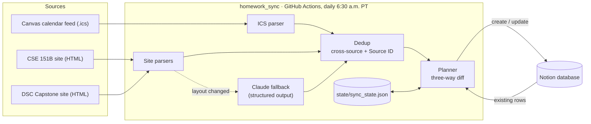

# homework-sync

[](https://github.com/flaviagt/homework-sync/actions/workflows/tests.yml)

Every morning before class, a GitHub Action collects new homework, quizzes, exams, and assigned readings from Canvas and from course websites that have no API, then syncs them into a single Notion database. Re-running it never creates duplicates and never overwrites what you've changed in Notion.

- **Canvas**, read from the personal calendar feed (`.ics`). It needs no API token, which matters because many schools disable token generation.
- **Course websites** are scraped from their schedule tables. If a site's layout changes and the parser stops understanding it, **Claude** extracts the items from the page text instead.
- **Notion** is updated through the official API. Each row is tagged Homework, Reading, Quiz, or Test and gets its course, due date, and a direct link.

## Architecture



## How it works

**Stable identity.** Every item carries a Source ID, stored in a hidden Notion column. Canvas items use the event's `UID`. Website items use a hash of the page URL plus the item's key: its code when it has one (`hw1`, `pa2`, `quiz3`), otherwise its normalized title. A link added to an assignment later doesn't change its ID.

**Three-way diff, so your edits survive.** For each item the planner compares three versions: the source now, the source as of the last sync, and the Notion row.

| Situation | What happens |
|---|---|
| No row with this Source ID | Row is created, with Status `Not started` |
| A row for the same thing already exists, added by hand or from another source (same course, same due date, matching title) | Not duplicated; it's listed in the output |
| Source unchanged since last sync | Nothing is written, even if you renamed the row in Notion |
| Source changed (e.g. due date moved) | Only the changed fields are sent |
| You deleted the row in Notion | It isn't re-created |
| Status | Never written after creation |

The "last sync" version lives in `state/sync_state.json` as per-field hashes, keyed by a hash of the Source ID. Nothing readable from Canvas ends up in the public repo.

**Scrapers that degrade gracefully.** Each course site has a small parser for its schedule table. If the table disappears or its headers change, the parser raises `LayoutChanged`. The page text then goes to Claude, which returns `{title, type, due_date, release_date, source_url}` through structured outputs. That result is cached against a hash of the page, so an unchanged page never costs a second API call. Without an `ANTHROPIC_API_KEY`, the run fails loudly instead of silently missing assignments.

**Cross-source dedup.** A course can post the same assignment on its website and in Canvas. A website item is dropped when Canvas has an item from the same course, with the same due date and a matching title ("HW1" ↔ "Homework #1: Backprop"). Canvas wins because its link goes to the submission page.

**Homework vs. reading.** Items that get submitted become **Homework**: assignments, milestones, reports. Material listed under a lecture, or lessons to work through, becomes **Reading**, due on the date of the class it's for. **Quiz** and **Test** are detected from titles, where "Midterm report" is Homework and "Midterm" is a Test.

**Scheduling around daylight saving.** GitHub's cron is UTC-only, so the workflow schedules both 13:30 and 14:30 UTC. A small gate job keeps whichever one is 6:30 a.m. in Los Angeles that day.

**Secrets.** The Canvas feed URL contains a private token. It's only read from the environment, fetch errors are re-raised without it, and a logging filter scrubs all secret values. In GitHub Actions, where logs of public repos are public, Canvas item titles are redacted from the output as well.

## Setup

### 1. Notion database

Create a database with these properties. You can rename them in [`config.toml`](config.toml).

| Property | Type | Notes |
|---|---|---|
| What | Title | |
| Course | Select | Options are created automatically |
| Type | Select | `Homework`, `Reading`, `Quiz`, `Test` |
| Due | Date | |
| Link | URL | |
| Status | Status | Must include `Not started` |
| Source ID | Text | Used for dedup. Hide it: column menu → *Hide in view* |

### 2. Notion integration

1. Go to [notion.so/profile/integrations](https://www.notion.so/profile/integrations), click **New integration**, choose **Internal**, and copy the secret (`ntn_…`).
2. Open the database as a full page, click **•••**, then **Connections**, and add the integration.
3. The database ID is the 32-character string before `?v=` in the page URL.

### 3. Canvas feed

In Canvas, go to **Calendar**, then **Calendar Feed** (bottom right), and copy the URL. Treat it like a password.

### 4. Configure

Edit [`config.toml`](config.toml) with:
- display names for your Canvas course codes
- the course websites to check

Each site needs a parser in [`homework_sync/sites/`](homework_sync/sites/). With an Anthropic key, a site whose parser fails still works through the Claude fallback.

### 5. GitHub secrets

In your repo, go to **Settings**, then **Secrets and variables**, then **Actions**, and add:

| Secret | Required |
|---|---|
| `CANVAS_ICS_URL` | yes |
| `NOTION_TOKEN` | yes |
| `NOTION_DATABASE_ID` | yes |
| `ANTHROPIC_API_KEY` | optional: enables the Claude fallback |

### 6. Test it

Go to **Actions**, open **Sync homework to Notion**, and click **Run workflow**. Tick **Dry run** to see what would sync without writing anything. After that it runs daily on its own.

## Running locally

```bash
python -m venv .venv && source .venv/bin/activate
pip install -r requirements-dev.txt
cp .env.example secrets.env        # fill in; secrets.env is gitignored
python -m homework_sync --dry-run  # prints what would change, writes nothing
python -m homework_sync --only cse151b,capstone --dry-run
pytest
```

Example dry-run output (illustrative):

```text
Sources
  canvas     25 items via ics
  cse151b    5 items via parser, 2 new since last run
  capstone   2 items via parser

Notion: would create 3, update 1; 28 already up to date
  + [CSE 151B] Homework: HW2 — due Mon Oct 19
  + [CSE 151B] Homework: PA2 — due Mon Oct 19
  + [DSC Capstone] Reading: Docker and Environments — due Mon Oct 12
  ~ [DSC 190] Homework: Homework #2: Mobility and mobile phone metadata — due Wed Oct 28
      due: '2026-10-27' → '2026-10-28'
```

### Assignment lists as CSV (Gradescope and Canvas)

Two commands write a plain list of assignments to `output/` (gitignored, since it's personal data):

```bash
python -m homework_sync.gradescope_export   # → output/gradescope_assignments.csv
python -m homework_sync.canvas_export       # → output/canvas_assignments.csv
```

Both files use the same columns: Course, Assignment, Due, Day, Status, Late due, Released, Link. Rows are sorted by due date.

- **Gradescope** has no public API, so the command logs in with `GRADESCOPE_EMAIL` and `GRADESCOPE_PASS` from `secrets.env` and reads the courses listed under `[gradescope]` in `config.toml`. It fills in every column.
- **Canvas** reads the calendar feed. The feed has no submission status, release dates or late deadlines, so those columns are blank. Assignments due at 11:59 PM show as `23:59`.

## Project layout

```text
homework_sync/
  canvas.py        .ics feed → items (course split, direct assignment links, due dates)
  sites/           course-website parsers, plus the Claude fallback (llm.py)
  dedup.py         cross-source and Source ID dedup
  planner.py       three-way diff → create / update / skip (pure, no I/O)
  notion.py        Notion REST client (API 2025-09-03), schema validation, property encoding
  state.py         committed state: site snapshots + per-field sync fingerprints
  sync.py, cli.py  orchestration and the command line
tests/             planner, dedup, parsers, Canvas, Claude and Notion handling (fakes, no network)
```

## Limitations

- Canvas's feed only includes items with a date. Undated module readings don't appear, which is why course websites are a separate source.
- Site parsers are heuristics written against each site's current markup. The Claude fallback covers redesigns, but only when an API key is set.
- GitHub can start scheduled runs late during busy periods. It also disables schedules in public repos after 60 days without activity; re-enable them from the Actions tab.
- Deleted rows stay deleted. To get one back, restore it from Notion's trash.

## Why I built this

My coursework this quarter lives in several places: Canvas for some classes, and course websites for others that don't use Canvas at all. Every morning I was checking all of them, and new readings and milestones were easy to miss. I wanted one list in Notion that stays current without my involvement.

My school disables Canvas API tokens, so I used the calendar feed instead. The course websites have no API, so I wrote small parsers for their schedule tables and added an LLM fallback. If a site gets redesigned mid-quarter, Claude extracts the items from the page text, so the sync degrades gracefully instead of silently dropping assignments.

The part I spent the most time on is the sync logic. It's idempotent, it deduplicates across sources, and it uses a three-way comparison between the source now, the source at the last sync, and the Notion row. That way a daily automation never overwrites a status or a note I've changed by hand. The core logic is covered by tests that run without network access.

## License

[MIT](LICENSE)
